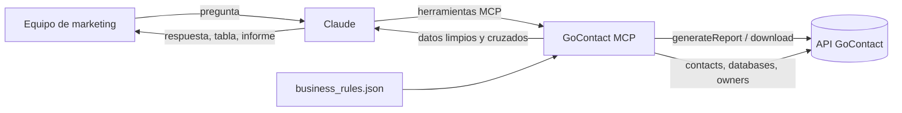

# GoContact MCP

Servidor MCP que conecta Claude con la API de **GoContact** para consultar leads, ventas y actividad del contact center en lenguaje natural.

> "¿Cuántos leads cargó cada proveedor la semana pasada y cuántos acabaron en venta?"
> Antes: esperar días a un Excel. Ahora: una pregunta.

## El problema

Los datos del contact center (leads cargados, llamadas, ventas por agente y por proveedor) llegaban en informes preparados a mano. Tardaban días, y sin ellos no se podía optimizar la inversión en captación ni el trabajo del equipo de ventas.

## La solución

Un servidor [MCP](https://modelcontextprotocol.io) de **solo lectura** que:

1. Pide los informes al **Report Designer** de GoContact por API.
2. Los descarga, limpia y cruza entre sí (leads ↔ llamadas ↔ ventas).
3. Aplica las **reglas de negocio** del equipo (qué es una venta, qué llamada está contestada, a qué proveedor pertenece cada lead).
4. Se los entrega a Claude, que responde preguntas, genera informes y detecta desviaciones.



## Herramientas

| Herramienta | Para qué sirve |
|---|---|
| `leads_mes` | Leads cargados en el mes, por base, formulario, proveedor, producto y outcome |
| `leads_detalle` | Detalle por lead cruzado con sus llamadas: ¿acabó en venta segura? |
| `ventas_mes` | Ventas registradas en el script, por producto, campaña, agente y proveedor |
| `resumen_agentes` | Por agente: llamadas, contestadas, minutos de conversación, ventas y conversión |
| `llamadas_servicio` | Actividad de campañas salientes y colas entrantes de servicio |
| `datos_informe` | Datos diarios compactos de un mes para montar un informe de seguimiento |
| `listar_bases` | Bases de datos de GoContact disponibles |
| `columnas_informe` | Cabeceras reales de cada CSV, para ajustar la configuración |
| `probar_conexion` | Diagnóstico: token e informe de prueba |

## Lo importante no es el código: son las definiciones

Conectar una API es la parte fácil. Lo difícil fue que los números cuadraran con el cierre manual. Algunas decisiones que salieron de validar contra datos reales (más detalle en [docs/reglas-de-negocio.md](docs/reglas-de-negocio.md)):

- **Una llamada con tiempo de conversación no siempre está contestada.** Casi la mitad de las llamadas marcadas "No Contactado" tenían segundos de conversación (buzones, locuciones). Contestada = outcome válido **y** conversación.
- **Venta segura = tres condiciones a la vez** en el script: grupo "Venta", producto válido y gestión de contratación válida.
- **El proveedor se asigna por el id de formulario**, no por el campo "proveedor", que viene escrito de mil maneras. El campo solo se usa como respaldo.
- **Las llamadas transferidas tienen varios tramos.** Se conservan todos (cada uno es trabajo de un agente) y solo se eliminan las filas duplicadas.
- **La fecha de carga del lead no es la fecha de creación de la base.** Si el informe no la trae, se pide a la API de contactos.

Todas estas reglas están en `config/business_rules.json`, fuera del código, para que alguien de negocio pueda cambiarlas sin tocar Python.

## Instalación

```bash
git clone https://github.com/marinscada/gocontact-mcp.git
cd gocontact-mcp
python -m venv .venv && source .venv/bin/activate
pip install -r requirements.txt

cp .env.example .env                                         # credenciales y plantillas
cp config/business_rules.example.json config/business_rules.json   # tus reglas de negocio
```

### Preparar GoContact

1. Crea un **usuario de servicio** con acceso a las campañas y colas que quieras consultar.
2. En el Report Designer, crea tres plantillas: *Contact state by last load date* (leads), *Calls With Script* (ventas) y *All Calls* (llamadas). Incluye Contact ID, agente y UUID de llamada. **No incluyas datos personales** (nombre, teléfono, email, DNI): no hacen falta.
3. Pon sus `templateId` en `.env`.
4. Ejecuta `columnas_informe` y ajusta el bloque `columnas` de `business_rules.json` a las cabeceras reales.

### Uso local con Claude Desktop

En `claude_desktop_config.json`:

```json
{
  "mcpServers": {
    "gocontact": {
      "command": "/ruta/a/.venv/bin/python",
      "args": ["/ruta/a/gocontact-mcp/server.py"],
      "env": {
        "MCP_TRANSPORT": "stdio",
        "GOCONTACT_BASE": "https://TU-DOMINIO.gocontact.es/poll",
        "GOCONTACT_USER": "usuario_servicio@dominio",
        "GOCONTACT_PASS": "...",
        "GC_TEMPLATE_LEADS": "123",
        "GC_TEMPLATE_VENTAS": "124",
        "GC_TEMPLATE_LLAMADAS": "125"
      }
    }
  }
}
```

### Uso remoto (para todo el equipo)

Con `MCP_TRANSPORT=streamable-http`, alojado con HTTPS y **OAuth delante**, y dado de alta como conector personalizado en Claude.

## Seguridad

- **Solo lectura**: ninguna herramienta modifica datos en GoContact.
- **Sin datos personales**: las plantillas se diseñan sin ellos y las respuestas trabajan con IDs y agregados.
- **Credenciales fuera del código**: van en variables de entorno; `.env` y `business_rules.json` están en `.gitignore`.
- **Escucha en local por defecto** (`HOST=127.0.0.1`). El servidor no incluye autenticación propia: para exponerlo en remoto, ponlo siempre detrás de un proxy con OAuth.

## Rendimiento

- Los informes se lanzan **en paralelo** y se descargan cuando están listos (GoContact los genera en diferido).
- Se guardan **30 minutos en caché**, así que preguntas encadenadas sobre el mismo mes son instantáneas.
- El token se renueva solo antes de caducar (24 h).

## Tests

```bash
pip install pytest
pytest
```

Prueban las reglas de negocio (asignación de proveedor, venta segura, llamada contestada, fechas) sin llamar a GoContact.

## Próximos pasos

- [ ] Mover la caché a Redis para el despliegue remoto con varios usuarios.
- [ ] Alertas automáticas cuando un proveedor cae por debajo de su conversión media.
- [ ] Tests de integración con CSV de ejemplo anonimizados.

## Sobre este proyecto

Construido por **Andrea** (Growth Marketing) con Claude como compañero de código, para dejar de depender de informes manuales y tomar decisiones con datos al momento.

Licencia [MIT](LICENSE).
